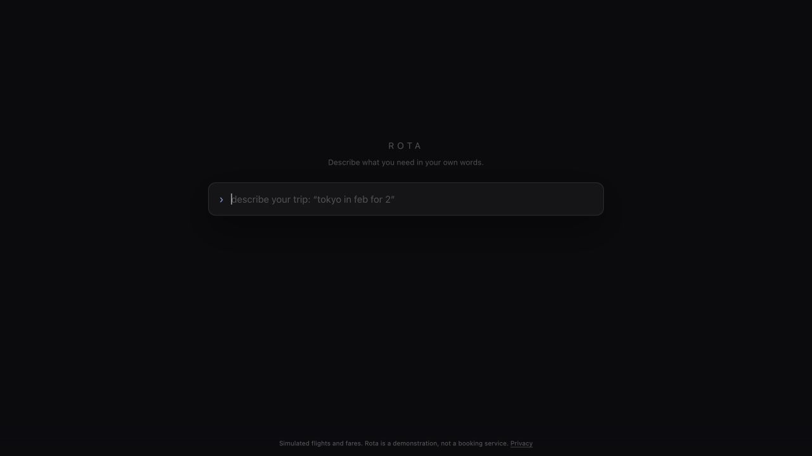

# Rota

[Try the live demo](https://rota.ugur.dev)



Rota turns natural-language trip requests into an explicit, editable search
intent. It searches simulated flight inventory with a deterministic engine and
shows why the best result matches the request.

## Demo notes

- Flights and fares are simulated. Rota is a demonstration, not a booking
  service.
- Natural-language parsing and the result explanation use the OpenAI API.
- The public demo allows 20 paid API requests per visitor every 10 minutes.
- Live AI pauses when the owner-funded monthly demo credits are used.
- Basic page visits are counted with Vercel Web Analytics. Search text is not
  stored by Rota. See the [privacy page](https://rota.ugur.dev/privacy).

## Run locally

Rota requires Node.js 20 or newer and pnpm 10.12.1.

```bash
pnpm install
cp .env.example .env.local
pnpm dev
```

Set `OPENAI_API_KEY` in `.env.local`. `ROTA_MODEL` optionally selects the
OpenAI model used by both model boundaries. The remaining variables in
[`.env.example`](.env.example) configure the in-process defense-in-depth gate.

Open [http://localhost:3000](http://localhost:3000) after the development
server starts.

## Architecture

- `src/app/` contains the Next.js routes and interaction surface.
- `src/lib/schema/` owns the shared Zod schemas and domain types.
- `src/lib/engine/` contains pure normalization, filtering, ranking, and
  explanation-fact logic.
- `src/lib/parser/` and `src/lib/prose/` are the only OpenAI model boundaries.
- `src/lib/availability/` generates deterministic simulated inventory.

The search engine runs without network access. The parser and prose boundaries
are isolated so their outputs can be validated before they enter deterministic
code. See [ARCHITECTURE.md](ARCHITECTURE.md) for the full boundary rules.

## Verify

```bash
pnpm test
pnpm typecheck
pnpm build
```

The test suite is network-free. Live model evaluation is a separate, optional
workflow and is not part of CI.

Operators should follow the [public demo security runbook](docs/operations/public-demo-security.md)
before enabling paid model routes in a hosted environment.

## Contributing and security

Issues and pull requests are welcome at the maintainer's discretion. This is a
portfolio demo, so there is no support or maintenance commitment. Read
[CONTRIBUTING.md](CONTRIBUTING.md) before proposing a change and report security
issues through [SECURITY.md](SECURITY.md), not a public issue.

## License

Rota is available under the [MIT License](LICENSE). Vendored agent-development
skills retain their upstream licenses; see
[THIRD_PARTY_NOTICES.md](THIRD_PARTY_NOTICES.md).
